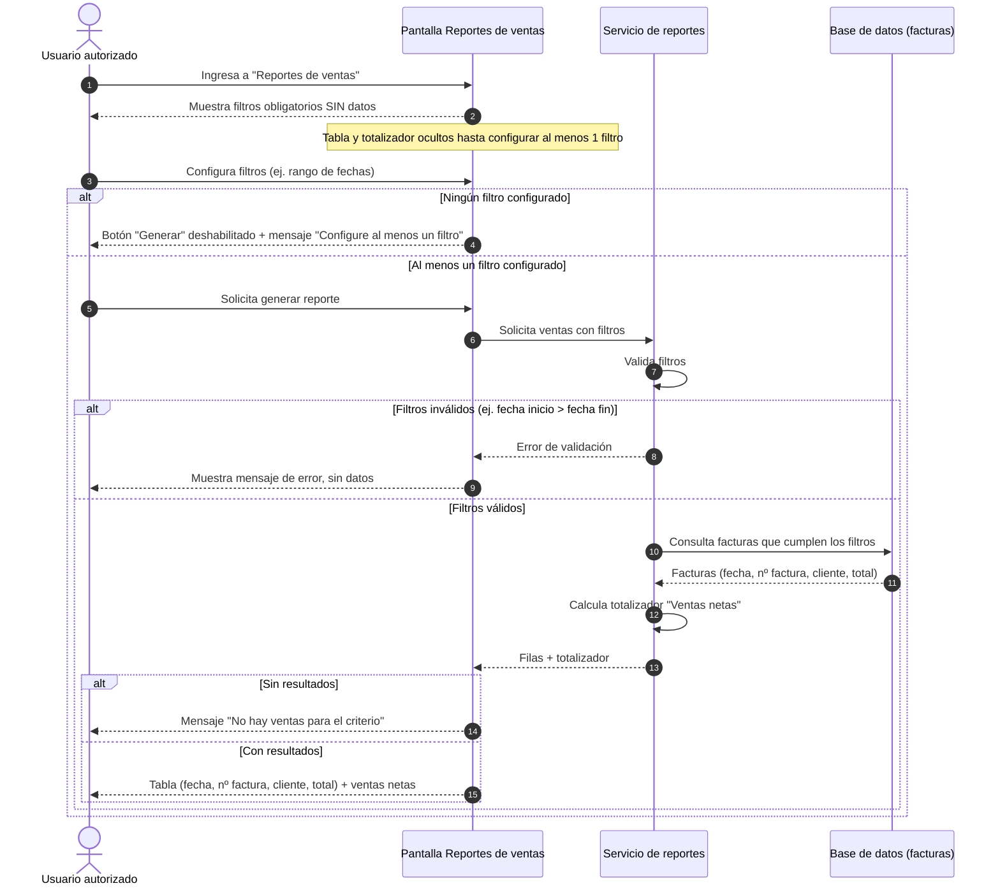

# HU-22: Reporte de ventas (diagrama de secuencia)

**Como:** usuario autorizado
**Quiero:** generar reportes de ventas filtrados por fecha
**Para:** analizar el rendimiento del negocio

## Diagrama de secuencia

## Criterios de aceptación

- Pantalla "Reportes de ventas" con filtros obligatorios.
- La pantalla no muestra datos hasta que el usuario configure al menos un filtro.
- Tabla con columnas: fecha, nº factura, cliente, total.
- Totalizador: ventas netas.
- Reportes estáticos y dinámicos.

## Supuestos (por confirmar)

- Basta con un filtro para habilitar la consulta.
- Ventas netas = suma de los totales de las facturas filtradas (no descuenta devoluciones ni anulaciones).
- Reportes estáticos y dinámicos no están detallados en la historia; el diagrama no los modela todavía.
