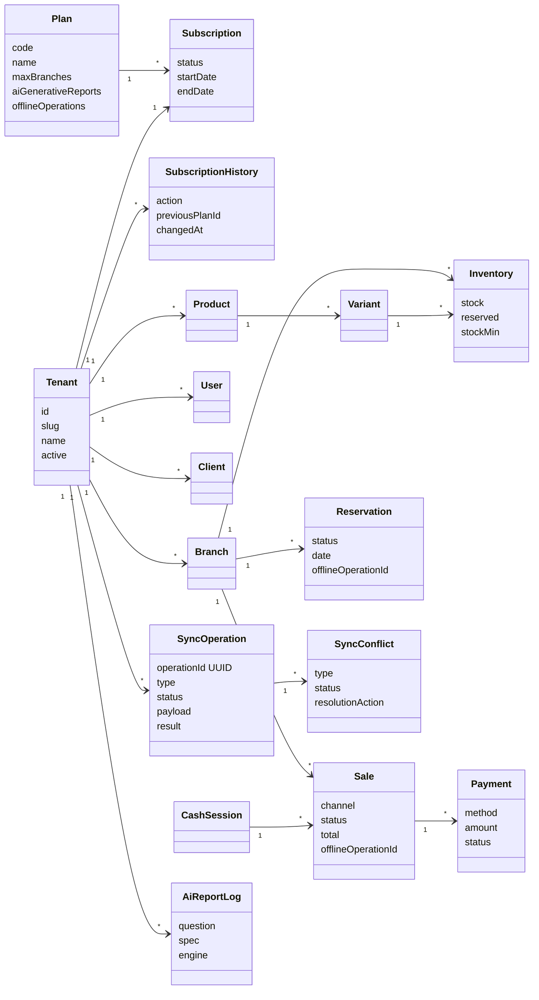
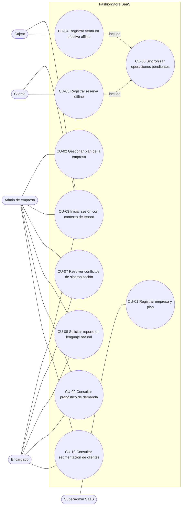
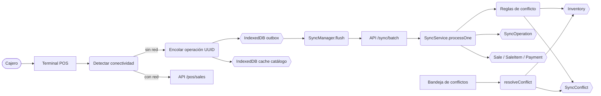
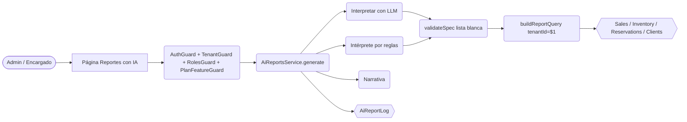
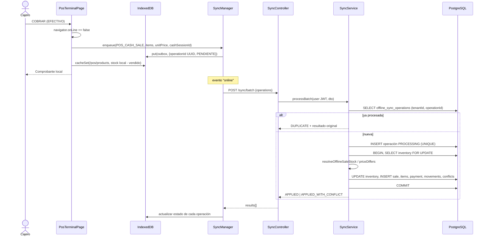
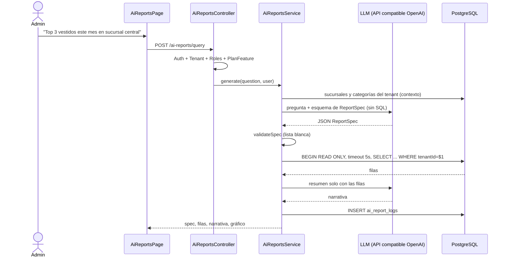
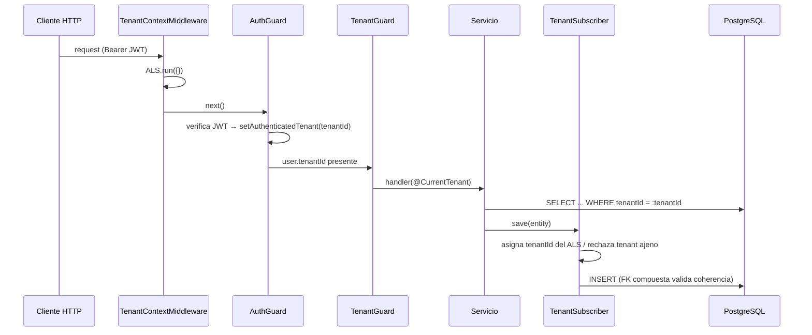
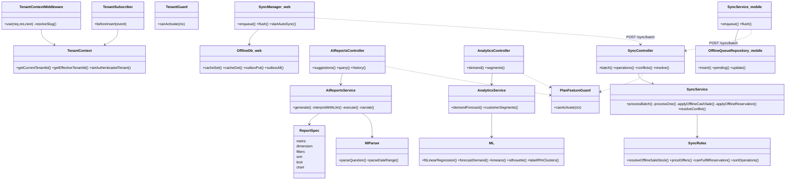

# FashionStore SaaS — Segundo Parcial (Metodología ICONIX)

Evolución del prototipo del Primer Parcial hacia una **plataforma SaaS multitenant** con
**operación offline** (web y móvil), **reportes generativos con IA** y **analítica con ML**.

Los diagramas están en Mermaid (se renderizan en GitHub / VS Code). Cada requisito se traza
hasta casos de uso, clases, archivos y pruebas automatizadas (sección 8).

---

## 1. Requisitos

### 1.1 Requisitos funcionales

| ID | Requisito |
|----|-----------|
| RF-01 | Registrar empresas (tenants) con plan y suscripción; historial de cambios de plan. |
| RF-02 | Cada empresa administra **solo** sus sucursales, empleados, clientes, productos, inventario, reservas y ventas. |
| RF-03 | El plan limita funciones: nº máximo de sucursales, reportes IA / analítica (Plan Profesional), operación offline. |
| RF-04 | El cajero puede registrar **ventas en efectivo sin conexión** (POS web). |
| RF-05 | El cliente puede registrar **reservas sin conexión** (web y móvil). |
| RF-06 | Las operaciones offline se guardan localmente (IndexedDB / SQLite) en una cola de pendientes. |
| RF-07 | Al recuperar la conexión la cola se sincroniza automáticamente, sin duplicar operaciones. |
| RF-08 | Se detectan y registran conflictos (stock, precio, caja cerrada, reserva sin stock) y un encargado los resuelve. |
| RF-09 | Usuarios autorizados solicitan reportes en **lenguaje natural** construidos con datos reales de su empresa. |
| RF-10 | Pronóstico de demanda por producto con sugerencia de reposición (ML supervisado). |
| RF-11 | Segmentación de clientes RFM (ML no supervisado). |

### 1.2 Requisitos no funcionales

| ID | Requisito |
|----|-----------|
| RNF-01 | Aislamiento de datos en 3 capas: API (JWT + TenantGuard), ORM (subscriber) y BD (FKs compuestas). |
| RNF-02 | El `tenantId` nunca proviene del cliente: se toma del JWT firmado. |
| RNF-03 | Sincronización idempotente (UUID por operación) y atómica (transacción + bloqueo pesimista). |
| RNF-04 | La IA nunca genera SQL: produce una especificación validada contra listas blancas; consultas parametrizadas, solo lectura y con timeout. |
| RNF-05 | La aplicación web es PWA instalable y navegable sin conexión. |
| RNF-06 | Los datos históricos del Primer Parcial se preservan (migración idempotente). |

---

## 2. Modelo de dominio (actualizado)



Toda entidad operativa tiene `tenantId`. Las relaciones críticas usan **FK compuestas**
`(xxxId, tenantId) → tabla(id, tenantId)` respaldadas por `UNIQUE (tenantId, id)`:

| FK compuesta | Impide |
|---|---|
| `fk_sales_branch_tenant` | venta de A en sucursal de B |
| `fk_inventory_branch_tenant` | inventario de A en sucursal de B |
| `fk_reservations_branch_tenant` | reserva de A en sucursal de B |
| `fk_payments_sale_tenant` | pago de A sobre venta de B |
| `fk_cash_sessions_branch_tenant` | caja de A en sucursal de B |
| `fk_clients_user_tenant` | cliente de A vinculado a usuario de B |

---

## 3. Diagrama de casos de uso



---

## 4. Especificación de casos de uso (curso básico / alterno)

### CU-04 Registrar venta en efectivo sin conexión
**Actor:** Cajero. **Precondición:** sesión iniciada y caja abierta con el catálogo ya cargado al menos una vez.

*Curso básico*
1. El cajero abre el Terminal POS; el sistema muestra el catálogo (desde la API o, sin red, desde IndexedDB).
2. El cajero agrega prendas al carrito y elige método **EFECTIVO**.
3. El cajero presiona **COBRAR**; el sistema detecta que no hay conexión.
4. El sistema genera un `operationId` (UUID), guarda la operación en la cola local con el precio cobrado y la caja vigente.
5. El sistema descuenta el stock en la copia local y muestra el comprobante local.
6. Se ejecuta **CU-06** al volver la conexión.

*Cursos alternos*
- 2a. Método TARJETA/QR sin conexión → el sistema informa que solo se acepta efectivo.
- 3a. La conexión se pierde durante el envío → se guarda en la cola igual que en el paso 4.

### CU-05 Registrar reserva sin conexión
**Actor:** Cliente (web o móvil).
1. El cliente elige prenda, sucursal, fecha y confirma.
2. Sin conexión, el sistema guarda la reserva en IndexedDB (web) o SQLite (móvil) con UUID.
3. Al sincronizar (CU-06) el servidor valida stock; si hay, crea la reserva y aparta stock; el cliente la paga desde "Mis reservas".

*Alterno* 3a. Sin stock → la operación queda **RECHAZADA** con conflicto `STOCK_UNAVAILABLE` y se sugieren sucursales con stock.

### CU-06 Sincronizar operaciones pendientes
1. Al detectar conexión (evento `online`, reactivación de la app o cada 30 s), el cliente envía la cola a `POST /sync/batch`.
2. El servidor ordena por fecha real del dispositivo y, por cada operación:
   1. Si `(tenantId, operationId)` ya existe → responde **DUPLICATE** con el resultado original.
   2. Reclama la operación (UNIQUE) y la aplica en una transacción con bloqueo `FOR UPDATE` del inventario.
   3. Aplica las reglas de conflicto y registra `SyncConflict` si corresponde.
3. El cliente actualiza el estado de cada operación (Sincronizada / Con conflicto / Rechazada).

*Alterno* 2b. Error técnico → se libera el reclamo y el cliente reintenta luego.

**Reglas de resolución (implementadas en `sync.rules.ts`):**

| Situación | Política | Resultado |
|---|---|---|
| Venta offline con stock suficiente | — | APPLIED |
| Venta offline mayor al stock | *La venta física prevalece*: se descuenta lo posible (stock nunca negativo) y se registra el faltante | APPLIED_WITH_CONFLICT (`STOCK_SHORTFALL`) |
| Venta que consume unidades reservadas | Se marca para que el encargado reasigne la reserva | `STOCK_SHORTFALL` |
| Precio cobrado ≠ precio vigente | Se respeta el monto cobrado (dinero real en caja) | `PRICE_CHANGED` (informativo) |
| Caja indicada ya cerrada | Se reasigna a la caja abierta y se avisa para el arqueo | `CASH_SESSION_CLOSED` |
| Reserva offline sin stock | *El servidor prevalece* (no hay dinero comprometido) | REJECTED (`STOCK_UNAVAILABLE`) + alternativas |
| Reenvío de la misma operación | Idempotencia por UUID | DUPLICATE |

### CU-07 Resolver conflictos
El Admin/Encargado abre "Conflictos offline", revisa el detalle y elige: *Reconocer faltante (ajuste)*,
*Anular venta y devolver stock*, *Aceptar precio cobrado*, *Conciliado en arqueo* o *Descartar*.
El encargado solo ve y resuelve conflictos de su sucursal.

### CU-08 Solicitar reporte en lenguaje natural
**Actor:** Admin o Encargado (Plan Profesional).
1. El usuario escribe una pregunta (ej. *"¿Cuáles fueron los 3 vestidos más vendidos este mes en la sucursal central?"*).
2. El sistema interpreta la pregunta con el LLM (o con el intérprete local si no hay API) y produce un `ReportSpec`.
3. El sistema valida el spec contra listas blancas; si es Encargado fuerza su sucursal.
4. El sistema construye SQL parametrizado con `tenantId = $1`, lo ejecuta en transacción **READ ONLY** con timeout de 5 s.
5. El sistema genera la narrativa (LLM o plantilla) y muestra gráfico, tabla y exportación CSV; registra la consulta en `ai_report_logs`.

*Alternos* 2a. Respuesta del LLM inválida → se usa el intérprete por reglas. 1a. Plan Básico → 403 con invitación a actualizar.

### CU-09 / CU-10 Analítica predictiva
- **CU-09:** series semanales de unidades por producto → regresión lineal (mínimos cuadrados) → pronóstico a *h* semanas,
  R², MAE en validación holdout, stock de seguridad (z = 1.65) y cantidad a reponer.
- **CU-10:** variables RFM por cliente → log + estandarización → K-Means++ (semilla fija) → silueta, nombres de segmento y acción sugerida.

---

## 5. Diagramas de robustez

Notación: **[Interfaz]** (boundary), **(Control)**, **{Entidad}**.

### CU-04 / CU-06 Venta offline y sincronización



### CU-08 Reporte en lenguaje natural



---

## 6. Diagramas de secuencia

### 6.1 Venta en efectivo offline + sincronización idempotente



### 6.2 Reporte generativo



### 6.3 Aislamiento en una petición cualquiera



---

## 7. Diagrama de clases de diseño (nuevos componentes)



---

## 8. Matriz de trazabilidad (Requisito → CU → Implementación → Prueba)

Pruebas: `T##` = `backend/scripts/test-saas-e2e.js` (API + PostgreSQL reales);
`U:` = pruebas unitarias Jest; `B:` = prueba en navegador (Playwright).

| Req. | CU | Implementación principal | Pruebas |
|---|---|---|---|
| RF-01 | CU-01 | `tenants/*.entity.ts`, `tenants.service.ts` (`createTenant`, `onModuleInit`) | Preparación T01–T33 |
| RF-02 / RNF-01 | CU-03 | `common/tenancy/*`, filtros en servicios, FKs compuestas en entidades | T01–T09, T11–T13 |
| RNF-02 | CU-03 | `TenantSubscriber`, `catalog.service.ts` (ignora `tenantId` del body) | T09, T10b |
| RF-03 | CU-02 | `plan-features.ts`, `branches.service.ts` (`maxBranches`) | T10, T30, T33 |
| RF-04 | CU-04 | `PosTerminalPage.tsx` (`registerOfflineSale`), `sync.service.ts` | T14, T15, B: venta offline |
| RF-05 | CU-05 | `CreateReservationPage.tsx`, `mobile/CreateReservationScreen.tsx` | T21, T22 |
| RF-06 / RNF-05 | CU-04/05 | `frontend/src/offline/db.ts`, `sw.ts` (NavigationRoute), `mobile/offlineQueue.repository.ts` | B: recarga offline del POS |
| RF-07 / RNF-03 | CU-06 | `syncManager.ts`, `mobile/syncService.ts`, `SyncService.processOne` | T16, U: `sortOperations`, B: sincronización |
| RF-08 | CU-06/07 | `sync.rules.ts`, `SyncConflictsPage.tsx`, `resolveConflict` | T17–T20, T23–T26, U: reglas |
| RF-09 / RNF-04 | CU-08 | `report-spec.ts`, `nl-parser.ts`, `ai-reports.service.ts`, `AiReportsPage.tsx` | T27–T30, U: spec/SQL/parser, B: reporte IA |
| RF-10 | CU-09 | `ml.ts` (`forecastDemand`), `analytics.service.ts`, `AnalyticsPage.tsx` | T31, U: regresión |
| RF-11 | CU-10 | `ml.ts` (`kmeans`, `labelRfmClusters`), `analytics.service.ts` | T32, U: K-Means |
| RNF-06 | — | `backend/scripts/migrate-multitenant.js` | Migración ejecutada sobre BD legada (datos preservados) |

---

## 9. Pruebas y cómo reproducirlas

```bash
cd backend && npm install
npm run migrate:multitenant      # BD del Primer Parcial → SaaS (idempotente)
npm run build && npm run start:prod
npx jest                         # 51 pruebas unitarias
npm run test:e2e:saas            # 64 pruebas E2E (crea y elimina 2 empresas de prueba)
npm run seed:synthetic           # (opcional) historial sintético para entrenar los modelos de ML
```

Resultado obtenido:

```
Tests: 51 passed, 51 total                       (Jest)
=== RESULTADO: 64 pruebas aprobadas, 0 fallidas ===   (E2E)
```

Variables para IA generativa (opcional; sin ellas se usa el intérprete local):
`AI_API_KEY`, `AI_API_URL` (endpoint de chat compatible con OpenAI), `AI_MODEL`.

---

## 10. Correcciones a la Etapa 1 detectadas durante esta fase

1. **El backend no arrancaba**: `BranchesModule` usaba `AuthGuard` sin importar `AuthModule`.
2. **Ventas POS, ventas web y reservas fallaban** con `tenantId NULL` (columna NOT NULL sin asignación) → `TenantSubscriber` + contexto ALS.
3. **`synchronize: true` eliminaba el blindaje**: `payments`, `cash_sessions` y `clients` no declaraban `tenantId`, y ninguna entidad declaraba las FKs compuestas → ahora están declaradas en las entidades.
4. Faltaban filtros por tenant en reservas, inventario, caja, usuarios, dashboard, reportes, POS, vitrina pública y variantes.
5. Un ADMIN de empresa podía listar **todas** las empresas (`GET /saas/tenants`) → restringido a `SUPERADMIN`.
6. `POST /pos/sales` fallaba por `FOR UPDATE` con `LEFT JOIN` → se bloquea solo la fila de inventario.
7. `migrate-multitenant.js` y la batería de pruebas citadas en el informe no estaban en el repositorio → agregadas.

## 11. Limitaciones conocidas

- Categorías, tallas, colores, temporadas y ciudades siguen siendo catálogos globales compartidos.
- `users.email` y `clients.email` son únicos **por empresa** `(tenantId, email)`: una persona puede usar el mismo correo en varias empresas. El login acepta `tenantSlug` y, si el correo y la contraseña coinciden en más de una empresa, responde `409 MULTIPLE_TENANTS` con la lista para elegir (sin revelar en qué empresas existe el correo).
- La app móvil tiene dos perfiles: el cliente (reservas offline) y el **cajero**, que ve la pantalla *Caja (POS)* y registra ventas de contado offline (SQLite: sucursal, existencias, clientes mínimos, ventas y detalle; el estado de sincronización se deriva de la cola `offline_operations`). Solo se admite efectivo sin conexión.
- Los modelos de ML se entrenan con las ventas de la empresa y se persisten por versión (`ml_models`). Con `npm run seed:synthetic` se puede generar un historial **sintético** marcado (`@sintetico.local`, SKU `SYN-`); las métricas de entrenamiento informan cuántas ventas son reales y cuántas sintéticas. El modelo supervisado es una regresión lineal por producto: su mejora frente al baseline ingenuo es modesta (≈10 % en datos sintéticos) y debe reportarse tal cual.
- Sin `AI_API_KEY` los reportes usan el intérprete local en español (cubre las consultas típicas, no lenguaje libre arbitrario).
